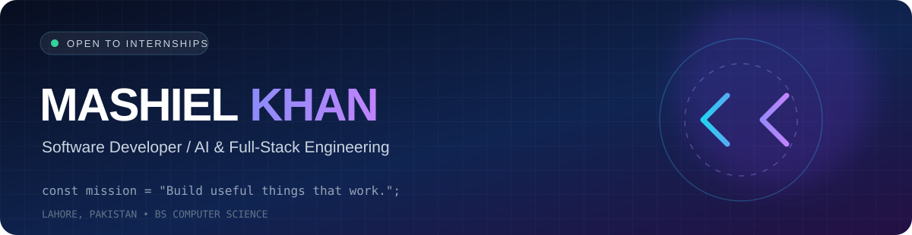
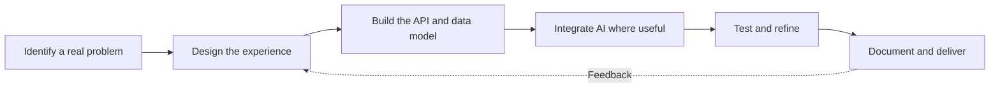

 

 

**Software Developer** · **AI / NLP Enthusiast** · **BS Computer Science** · **Lahore, Pakistan**

[**Explore projects**](#-selected-projects) · [**Toolbox**](#-toolbox) · [**Engineering approach**](#-how-i-build) · [**Contributions**](#-github-contributions)

---

### `> whoami`

I'm **Mashiel Khan**, a BS Computer Science student building real-world software across **web, AI, APIs, mobile, and data systems**. I care about more than shiny interfaces: I want to understand how products work end to end, test the important paths, and communicate decisions clearly.

- 🔭 **Currently focused on:** AI-enabled applications, full-stack systems, and developer tools
- 🧠 **Learning by building:** semantic search, applied NLP, integrations, and scalable architecture
- 🎯 **What matters to me:** useful features, readable code, privacy, reliability, and thoughtful UX
- 🤝 **Open to:** software engineering internships, projects, and technical collaboration

## 🧩 What I build

| 🧠 AI & NLP | 🌐 Full-stack web | 📱 Mobile | 🛠️ Developer tools |
|:---:|:---:|:---:|:---:|
| Resume parsing, semantic matching, search | Interactive apps, APIs, auth, database-backed workflows | React Native / Expo and Flutter exploration | .NET MCP servers, SQL, tests, automation |

## 🚀 Selected projects

<table>
<tr>
<td width="50%" valign="top"><h3>🧠 <a href="https://github.com/Mashielkhan/talentlens-ai">TalentLens AI</a></h3><strong>AI-powered resume analyzer & job matcher</strong>
Resume/CV processing, semantic comparison, user-controlled editing, and reviewable evaluation workflows.

<code>AI / NLP · Python · Full-stack · Testing</code>

<em>Development project; no public hosted demo</em>
</td>
<td width="50%" valign="top"><h3>🗺️ <a href="https://github.com/Mashielkhan/Mapify">Mapify</a></h3><strong>Interactive roadmap & flowchart builder</strong>
Node-based visual workspace for diagramming learning paths, flows, and ideas.

<code>Next.js · React Flow · Firebase · Auth0</code>
</td>
</tr>
<tr>
<td width="50%" valign="top"><h3>🧶 <a href="https://github.com/Mashielkhan/KnitKraft">KnitKraft</a></h3><strong>Wool marketplace & supply-chain workflows</strong>
Multilingual application exploring how producers, suppliers, buyers, and logistics roles interact.

<code>Node.js · Express · MongoDB · EJS</code>
</td>
<td width="50%" valign="top"><h3>⚙️ <a href="https://github.com/Mashielkhan/library-mcp-server">Library MCP Server</a></h3><strong>Model Context Protocol meets .NET</strong>
Catalog search, inventory, borrowing and returns with SQL Server, EF Core, and tests.

<code>C# · .NET 8 · SQL Server · EF Core</code>
</td>
</tr>
<tr>
<td width="50%" valign="top"><h3>📚 <a href="https://github.com/Mashielkhan/note-vec">NoteVec</a></h3><strong>Semantic academic knowledge discovery</strong>
A learning-resource platform concept with vector search and connected knowledge visualization.

<code>Next.js · MongoDB · D3.js · Vector Search</code>
</td>
<td width="50%" valign="top"><h3>📱 <a href="https://github.com/Mashielkhan/contentforge">ContentForge</a></h3><strong>Mobile content workflow app</strong>
A React Native/Expo project for creation, repurposing, and organizing content.

<code>Expo · React Native · TypeScript</code>
</td>
</tr>
</table>

<b>🧪 More projects and experiments</b>

 

- [HousePrice Prediction](https://github.com/Mashielkhan/HousePrice-Prediction) — machine learning / predictive modeling coursework
- [AppVision React](https://github.com/Mashielkhan/appvision-react) — frontend application experiments
- [Portfolio](https://github.com/Mashielkhan/mashielkhan-portfolio) — personal developer portfolio built with Next.js

> **Build status varies by repository.** Browse the project READMEs for current implementation notes, setup instructions, and limitations.

## 🧰 Toolbox

**Languages & fundamentals**

**Frontend, design & mobile**

**Backends, databases & cloud**

**Engineering tools**

## 🏗️ How I build

I enjoy working across the whole product lifecycle — not only writing UI components.

<b>🔍 Engineering areas I care about</b>

 

| Area | My focus |
| --- | --- |
| Frontend | Accessible, responsive interfaces and useful interactions |
| Backend | API contracts, validation, authentication, and data modeling |
| Applied AI | NLP, embeddings, matching, and honest evaluation |
| Quality | Automated tests, meaningful errors, and repeatable setup |
| Delivery | Git, Docker, CI workflows, documentation, and deployment learning |

## 📊 GitHub contributions

**Public GitHub statistics**

 

Stats use a third-party card provider; the linked GitHub contributions page is the authoritative source. Language share is based on repositories, not a proficiency score.

## 🐍 Contribution snake

<picture>
  <source media="(prefers-color-scheme: dark)" srcset="https://raw.githubusercontent.com/Mashielkhan/MashielKhan/output/github-contribution-grid-snake-dark.svg" />
  <source media="(prefers-color-scheme: light)" srcset="https://raw.githubusercontent.com/Mashielkhan/MashielKhan/output/github-contribution-grid-snake.svg" />
  
</picture>

Generated automatically by GitHub Actions. [See snake workflow](https://github.com/Mashielkhan/MashielKhan/actions/workflows/snake.yml).

---

### 💬 Let's build something useful

I'm looking for opportunities to **learn, collaborate, and contribute** to real engineering teams.

**`const mindset = "Build → Test → Learn → Improve";`**

Made with Markdown, SVG, GitHub Actions, and a healthy obsession with improving things.

